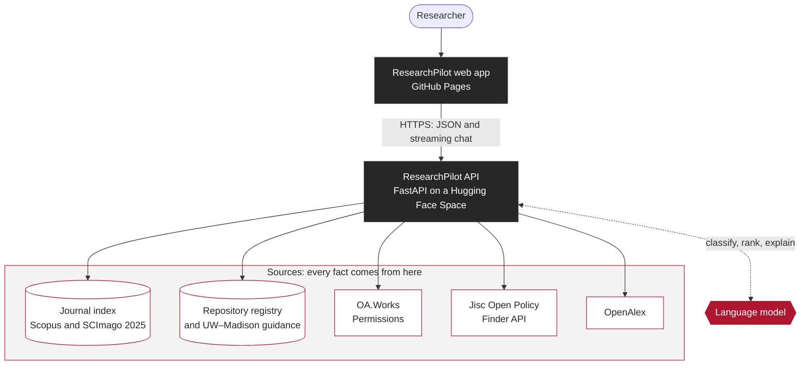

<p align="center">
  <a href="https://mohithnikesh1.github.io/ResearchPilot/">
    
  </a>
</p>

**ResearchPilot** is an independent publishing and research-data assistant for **University of Wisconsin–Madison researchers**. It helps you choose where to publish, understand what you may share, and find a home for your data, and it shows the evidence behind each suggestion. Open it in any browser; there's nothing to install or sign in to.

**[Open ResearchPilot](https://mohithnikesh1.github.io/ResearchPilot/)** | [Backend on Hugging Face](https://huggingface.co/spaces/mohithnikesh/ResearchPilot) | Version 3.0.0 | [All rights reserved](LICENSE)

> [!NOTE]
> ResearchPilot is an independent tool, **not an official UW–Madison or UW–Madison Libraries service**. Its results support decisions; they do not guarantee acceptance, funding eligibility or permission to deposit.

## What you can do

### Find a journal

Browse by **subject** or paste your **title and abstract**. ResearchPilot ranks journals from a Scopus and SCImago index of **30,118 active journals**.

- A **fit score** out of 100 that shows how it was worked out. It is not an acceptance probability.
- SJR quartile **per subject category**, each linked to SCImago.
- Indexation status, so new, renamed and discontinued titles are flagged.
- Recent articles from OpenAlex as evidence of fit.
- Links to the journal website and author guidelines.
- Compare up to five journals, export CSV, BibTeX or RIS, and draft a cover letter.

### Share your article

Find out which version you may share, where, and when.

- **With a DOI**, article-level permissions come from OA.Works, the data behind cOAlition S's Journal Checker Tool.
- **With only a journal name or ISSN**, the journal's record comes from the Jisc Open Policy Finder API, with each option kept separate.
- Each option is checked against your version, deposit location, licence and funder.
- Required deposit statements are shown word for word.
- A ShareYourPaper deposit link and MINDS@UW guidance are included.

### Find a data repository

Describe your dataset in two short steps and get matched repositories.

- Matches come from a **curated registry of 24 repositories** with reviewed facts.
- MINDS@UW and Dryad (through UW–Madison's membership) are offered when your requirements allow.
- Requirements for a DOI, versioning, embargo, licence and size are checked.
- Sensitive and personal data trigger review warnings.

### Ask the chat assistant

Ask about publishing and research data and get streamed answers.

- Answers draw on curated UW–Madison guidance: APC agreements, open-access policy, MINDS@UW and data-management support.
- It explains metrics, quartiles, FAIR data, embargoes and licences in plain language.
- For journal-policy questions it pulls live Open Policy Finder data.
- It can open the right tool for you.

## Where the answers come from

Language models are good at reading a manuscript and explaining options, but they are unreliable sources of facts. ResearchPilot keeps the two jobs apart:

| Question | Answered by | What the AI does |
|---|---|---|
| Which journals exist, and their ISSNs, quartiles and index status | Bundled Scopus and SCImago 2025 index (48,888 source records) | Maps your manuscript to a fixed subject list and ranks the candidates it is given |
| May I deposit this version, where, and when? | OA.Works Permissions (by DOI) or Jisc Open Policy Finder (by journal) | Writes a short advice note from the retrieved facts only |
| Which repository suits my dataset? | Curated registry with reviewed source links | Picks registry entries and explains the fit |
| Does UW–Madison support my APC? | Curated UW–Madison guidance, reviewed October 2026 | Explains the options; never decides eligibility |

- **Unknown stays unknown.** A missing embargo is never shown as "no embargo", and a missing record is never shown as "not permitted".
- **Policy options stay whole.** One option's licence is never combined with another option's deposit location or timing.
- **No invented links.** Journal and publisher links come from matched metadata or checked publisher pages.
- **Stated limits.** Every result lists which filters were applied and what still needs a manual check.

## How it fits together



<details>
<summary><b>What's in this repository</b></summary>
<br>

The live site is **one self-contained file** with no build step and no external scripts. Its typefaces load from Google Fonts.

```text
index.html                 the complete app: inline styles, configuration block,
                           application script, embedded logo and favicon
assets/readme-banner.svg   banner used by this README
LICENSE                    proprietary licence (all rights reserved)
```

The other files in `assets/` are left over from the earlier multi-file version. `index.html` doesn't load them.

</details>

<details>
<summary><b>Configuration</b></summary>
<br>

Every API call uses `apiBase` in the inline configuration block near the end of `index.html`:

```js
window.RESEARCHPILOT_CONFIG = Object.freeze({
  apiBase: "https://mohithnikesh-researchpilot.hf.space",
  model: "gpt-5.6-luna"   // kept for request compatibility; the backend chooses the model
});
```

API keys and other secrets never belong in this repository. They are stored in the Hugging Face Space settings.

</details>

<details>
<summary><b>Hosting and publishing updates</b></summary>
<br>

The site is served by **GitHub Pages** from the `main` branch (repository root) and calls the live backend at <https://mohithnikesh-researchpilot.hf.space>.

1. Deploy any matching backend change first. Check that [`/api/health`](https://mohithnikesh-researchpilot.hf.space/api/health) reports `version: "3.0.0"` and `ready: true`.
2. Update `index.html` on `main`. GitHub Pages republishes it automatically.
3. If the page is ever served from a different origin, add that origin to `RESEARCHPILOT_ALLOWED_ORIGINS` in the Space settings.

</details>

## Privacy

> [!IMPORTANT]
> Don't enter confidential manuscripts or identifiable personal or health data.

- Manuscript details, dataset descriptions and chat messages may be sent to **OpenAI** to provide AI assistance.
- **OpenAlex** receives subject keywords, not your unpublished title or abstract.
- Policy checks send only the **DOI or journal identifiers** to the relevant services.
- The page loads its typefaces from **Google Fonts**, so Google receives your IP address and browser details.
- Usage statistics are **counts only**. Your questions, abstracts and DOIs are never stored for analytics.

## Sources and attribution

| Source | Used for |
|---|---|
| [SCImago Journal & Country Rank](https://www.scimagojr.com) | 2025 SJR metrics and quartiles (© SCImago Lab, based on Scopus® data), used under non-commercial terms with attribution |
| [ShareYourPaper Permissions](https://shareyourpaper.org/permissions) (OA.Works) | Article-level self-archiving permissions |
| [Jisc Open Policy Finder](https://openpolicyfinder.jisc.ac.uk) | Journal-level sharing policies, licensed CC BY-NC-ND 4.0 |
| [OpenAlex](https://openalex.org) | Journal metadata, related works and citation chains |
| [re3data](https://www.re3data.org) | Where to check repository details |
| [UW–Madison Libraries](https://www.library.wisc.edu/research-support/scholarly-communication/open-access/publishing-support/) | Current APC agreements and publishing support: always confirm eligibility here |

---

© 2026 Mohith Nikesh. All rights reserved. See [LICENSE](LICENSE).
Not affiliated with or endorsed by the University of Wisconsin–Madison.
